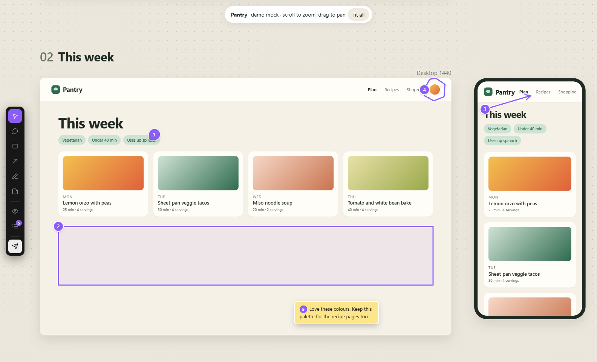
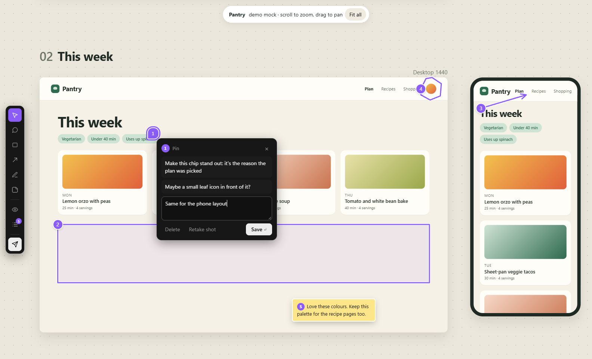
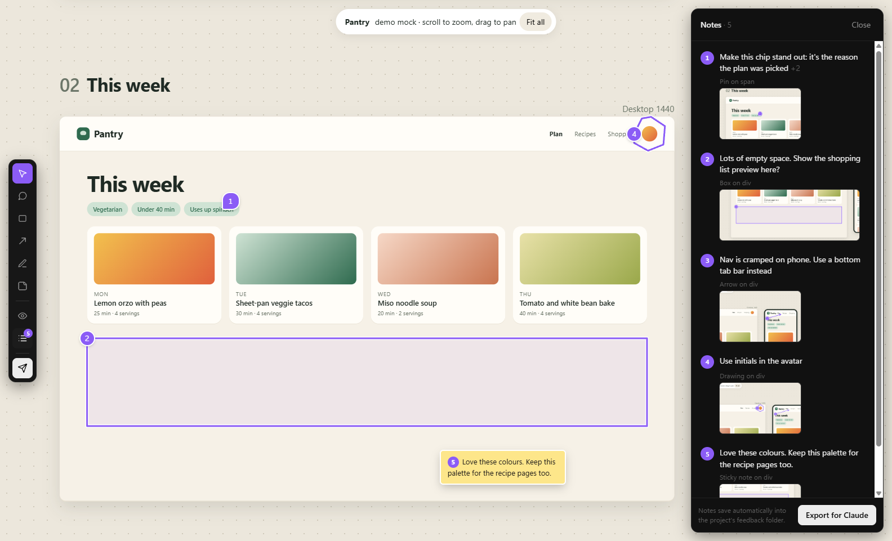
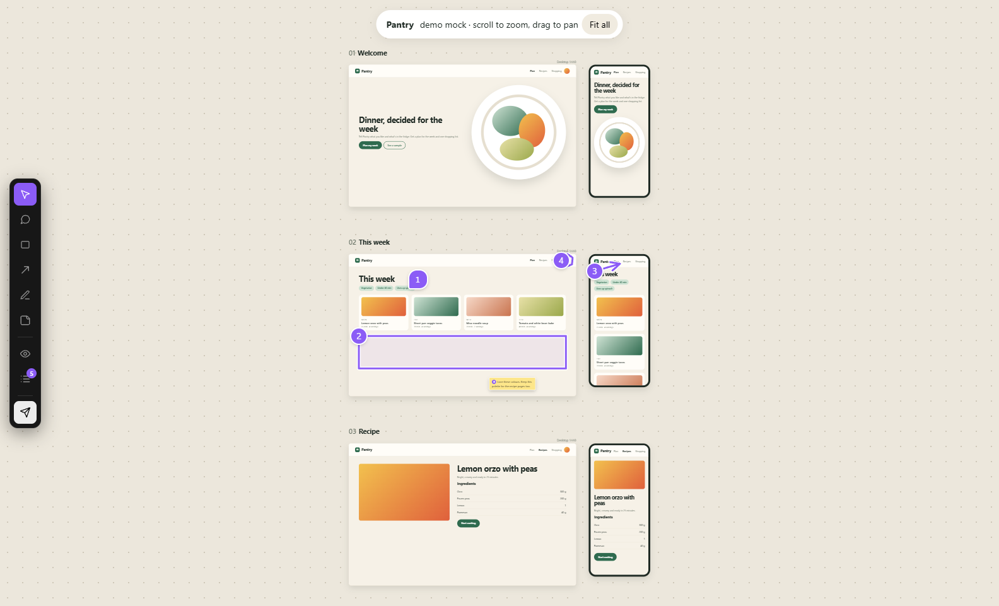
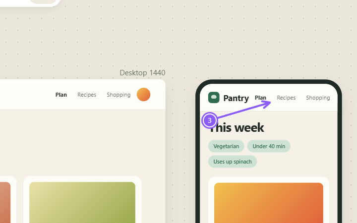

# Annotato

Mark up any design you're iterating on (pins, boxes, arrows, freehand drawings, sticky notes), then hand every note to Claude at once. It works on HTML mocks and pages on disk (including Figma-style zoomable canvases of app screens), and on apps running on a dev server (React, Vite and similar), in any project.

Everything stays on your computer. Nothing is uploaded.



## Setup

Windows 10 or 11 only (the launcher, the file pickers and the Send to menu are Windows features). You need:

- [Node.js](https://nodejs.org) 22 or newer. There are no npm packages to install.
- Google Chrome, or Microsoft Edge as a fallback.

Clone or download this repository anywhere, then run `Add to Send-to menu.cmd` once if you want the right-click entry.

**Try it:** drag the `demo` folder onto `Annotato.cmd`. It's a made-up meal-planner app laid out as a zoomable canvas of desktop and phone screens.

## Use it

1. **Open what you want to review.** It opens in its own Chrome window (Edge if Chrome is missing).
   - **A mock or page on disk:** drag its HTML file or folder onto **`Annotato.cmd`**, or right-click it and choose **Send to › Annotato**. If the Send to entry is missing, run `Add to Send-to menu.cmd` once.
   - **A running app:** start its dev server first (usually `npm run dev`, or ask Claude to). Then double-click `Annotato.cmd`, enter the app's address (e.g. `http://localhost:5173`) and choose the project folder. Dragging an app's project folder onto the launcher takes you to the same place. Live reload keeps working while you review.
   - Double-clicking the launcher also lists recent mocks and apps to reopen.
2. **Mark it up** with the bar on the left:

   | Tool | Key | What it does |
   |---|---|---|
   | Browse | V | Use the mock normally (click frames, buttons) |
   | Pin | C | Click a spot, type a comment |
   | Box | B | Drag around an area |
   | Arrow | A | Drag from where to where |
   | Pen | P | Draw freehand. Strokes join into one note until you type its comment |
   | Sticky note | N | Click to place a note that stays visible on the canvas |
   | Hide marks | H | Hide or show all marks |
   | Notes list | L | Side panel with every note and its screenshot |

   - Enter saves a comment. Shift+Enter adds a new line. Esc closes the comment box or goes back to Browse.
   - Ctrl+Z removes the last note or stroke. After a delete, Ctrl+Z brings the note back.
   - Click a number to reopen a note, add to it, edit it, delete it or retake its screenshot.
   - To talk instead of type, press **Win+H** in a comment box: Windows dictation types for you.
   - Scroll still zooms the canvas while a tool is on. Hold **Space** to use the mock with the mouse (for example, to drag-pan) without leaving the tool.
3. **Export.** Press the send button at the bottom of the bar (or Export for Claude in the notes list). The tool writes a bundle and puts a ready message on your clipboard. Paste it into any Claude session.

<p> </p>

Marks are attached to the element under them, so they follow zoom and pan. A mark made on a full-size screen shows only when that screen is open again. Notes save automatically as you work, so you can close the window and continue later.



## What gets written

Inside the project you reviewed: next to a mock's HTML file, or at the top of a running app's project folder:

```
feedback/
  _draft/                 notes in progress (<page>.json or app.json + screenshots), cleared when you start a fresh round
  2026-11-05-1530/        one bundle per export
    feedback.md           every note: comments, screen, element, selector, position, screenshot links
    01.png, 01-window.png crop around note 1 (the mark drawn on it), and the whole window at that moment
    notes.json            the same data as JSON
```

Each note in `feedback.md` looks like this:

```markdown
## 3. Arrow: Nav is cramped on phone. Use a bottom tab bar instead


Comments:
- (19:11) Nav is cramped on phone. Use a bottom tab bar instead

- View: Pantry: demo mock · window 1584×961
- Element: `div.frame.phone[data-screen="week:phone"]`
- Element text: "Pantry Plan Recipes Shopping This week Vegetarian Under 40 min Uses up spinach MON Lemon orzo with peas 25 min · 4 servings TUE Sheet-pan ve"
- Inside: div#vp.viewport › div#world.world
- Also under the mark: `main.page`, `div.top`
- Selector: `div[data-screen="week:phone"]`
- Position: arrow from 10%, 13% to 51%, 7% of the element; it points at `div.top`
- Whole window when the note was made: [03-window.png](03-window.png)
```

with `03.png` cropped around the mark:



The screenshots can contain private photos, so consider adding `feedback/` to the mock project's `.gitignore`.

## For Claude: reading a bundle

When asked to "read feedback/<date>/" (or given the path to its `feedback.md`):

1. Read `feedback.md`. It starts with instructions. Then look at **every** `NN.png`: the reviewer's mark is drawn in purple with its number. Use `NN-window.png` to see where on the canvas the note sits.
2. Find each element in the mock's source from "Element", "Element text", "Inside" and "Selector". Selectors are as rendered at the time: nth-child paths can be off by a little, so prefer the text and the classes. "View" says whether a full-size screen was open.
3. Act on all notes. Then reply with one line per note number: what you changed, or why you skipped it and what the reviewer needs to decide.

## How it works (for maintenance)

- `server.js`: a small Node server on `127.0.0.1:4321`, no packages. It serves the mock's git repo (so `../../brand/...` links work, and links from the site's top folder like `/css/site.css` are found by walking up from the page; outside a git repo only the page's own folder is served) and injects `overlay.js` into each HTML page. Each running app gets its own port from 4322 up (saved in `work/apps.json`). That port passes everything through to the dev server, adds the overlay to HTML pages, and passes the live-reload connection through. Only `localhost` apps are accepted. It saves drafts, takes screenshots through Chrome's built-in debugging port (`9333`, review profile only), writes bundles, and quits after 30 idle minutes.
- `overlay.js`: the annotation layer, in a shadow root so it never clashes with the mock's CSS. Notes store points relative to the element they're on, plus a text fingerprint of that element, so they survive zoom, pan and re-renders.
- `home.html`: the start page (choose a file, open a running app, recent list).
- `Add to Send-to menu.cmd`: puts "Annotato" in the right-click Send to menu.
- `work/` (git-ignored): the review browser's own profile, the recent list and `server.log`.

No dependencies beyond Node and Chrome or Edge: nothing to install or update, no service, no cost.

Optional hook for a mock: define `window.cfContext = () => 'Welcome, phone, full size'` and that text is added to each note's "View" line.

## Licence

MIT. See [LICENSE](LICENSE).
